  

<h1 align="center">Yassine Jemi</h1>

  Linux enthusiast • NixOS user • Python developer

---

## About

I build small, practical software and learn by working on real projects.

My main interests are Linux, NixOS, Python, developer tools, and command-line applications. I prefer understanding how things work and building useful tools over following trends.

## What I'm Working On

* Linux and NixOS tooling
* Python CLI and TUI applications
* Improving software structure and code quality
* Learning through open-source projects and contributions

## Projects

### SClipVault

A lightweight clipboard history manager for Linux with automatic Wayland and X11 backend detection, clipboard monitoring, and local SQLite storage.

**Python • SQLite • Wayland • X11**

### TypeSpeedTest

A typing-speed application focused on live WPM, accuracy, and typing feedback.

**Python**

### Nixctl

A small NixOS command-line tool for common system maintenance and rebuild operations.

**Python • NixOS**

## Technologies

**Languages**

Python

**Systems & Tools**

Linux
NixOS
Nix
Git
GitHub
SQLite
Wayland
X11
Home Manager

**Interests**

System tooling
CLI applications
Linux customization
Open source

## Approach

I prefer practical projects, simple solutions, and understanding what I build rather than relying on abstractions I don't understand.

  <a href="https://github.com/Yassine-Jemi01">GitHub</a>

